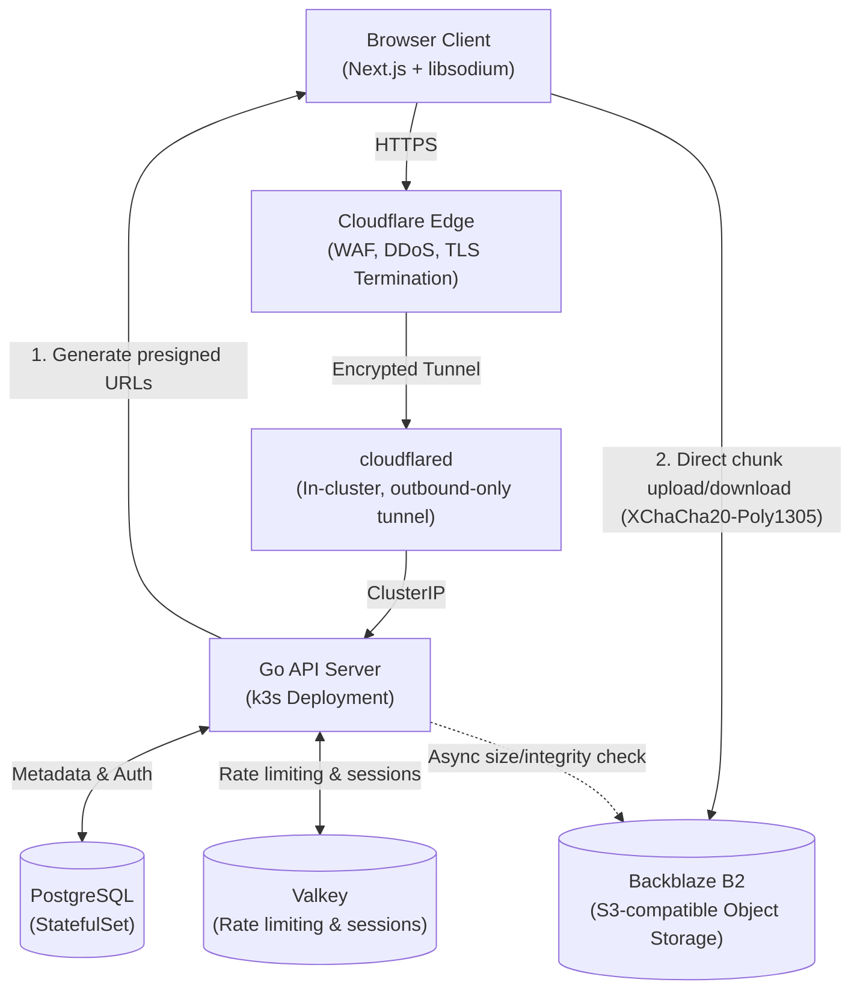

# Quartz Drive

**End-to-end encrypted (E2EE) cloud storage**

The server never receives your password or your plaintext files. File contents and names are encrypted in the browser before upload.

[](LICENSE)

---

https://github.com/user-attachments/assets/b3504f7e-45ca-470e-ac38-97df6382da1d

> Check out the live demo [here](https://quartzapp.top?utm_source=github_repo_readme&utm_medium=link&utm_campaign=demo).

> [!CAUTION]
> Quartz Drive is currently in the **alpha** stage and is not production-ready. Do not upload sensitive or unbacked-up data.
> 
> The architecture relies on standard cryptographic primitives (libsodium, OPAQUE, X-Wing), but the implementation has not undergone a formal third-party audit. You are using Quartz Drive at your own risk.

---

### Live Demo

> [!WARNING]
> * **Don't upload sensitive files**, or files that aren't backed up elsewhere.
> * **Data loss can occur at any time**, since this is a demo environment under active development.
> * Demo sessions are set to **expire after 1 hour** or on user-initiated sign out.
> * Storage quota is limited to 100MB and APIs are heavily rate limited.
> * Every demo session contains pre-seeded test files. You can delete them, inspect them, or upload new files.
>
> Terms are subject to change.

The demo is available [here](https://quartzapp.top?utm_source=github_repo_readme&utm_medium=link&utm_campaign=demo).

### Architecture & Security Highlights

* **Password-Authenticated Key Exchange (OPAQUE PAKE Protocol)**: Replaces traditional password transmission with the OPAQUE protocol (using the Rust `opaque-ke` crate via CGO on the server, and `@serenity-kit/opaque` in the browser). The server never receives raw passwords or password hashes over the wire.
* **Hierarchical Key Architecture**: Keys derive deterministically through a strict hierarchy: `(OPAQUE export key → Master Key → Account Encryption Key → Node Keys → File Block Keys → Decrypted File)`. Folder and file keys use a **post-quantum-resistant hybrid (X-Wing: X25519 + ML-KEM)** asymmetric envelope wrapping, enabling secure folder operations without re-encrypting child nodes.
* **Cryptographically Bound Sessions (DPoP)**: Demonstrating Proof-of-Possession (RFC 9449) tokens are bound to a non-extractable browser key pair stored in IndexedDB. Every API request includes a signed proof of the HTTP method and URL, so a stolen token alone cannot be replayed without access to the private signing key.
* **Persistent Sessions in Browser**: Device private keys stored in IndexedDB unwrap server-stored account key envelopes without re-prompting for passwords. The server only stores ciphertext blobs it cannot decrypt.
* **Email Enumeration Resistance**: Equalized server-side work during login (generating deterministic fake OPAQUE records for unknown emails) to make timing-based email enumeration significantly harder.

The security model limits what a compromised API, database, or storage bucket can reveal: file contents and names are encrypted client-side, user emails are encrypted with an HMAC blind index, and the server never receives raw passwords. Like all browser-based cryptography, it cannot protect against a compromised web host serving malicious JavaScript, and weak passwords remain vulnerable to offline guessing if both the database key blobs and server-side OPAQUE secrets leak.

## Technology Used

| Layer                | Technologies & Libraries                                                                                                      |
|:---------------------|:------------------------------------------------------------------------------------------------------------------------------|
| **Backend**          | Go 1.27+, GORM, JSON Web Tokens, Asynq (Background worker)                                                                    |
| **Frontend**         | Next.js 16, Zustand, Tailwind CSS                                                                                             |
| **Cryptography**     | Libsodium (`libsodium-wrappers-sumo`), OPAQUE PAKE (Rust `opaque-ke` via CGO / `@serenity-kit/opaque`), X-Wing, Web Crypto     |
| **Database & Cache** | PostgreSQL 18, Valkey (Redis fork)                                                                                            |
| **Infrastructure**   | Kubernetes (k3s on ARM64), `cloudflared` (Cloudflare Tunnel), GitHub Actions (Self-Hosted In-Cluster Runner)                  |
| **Storage & Edge**   | Backblaze B2 (Production) / SeaweedFS (Local Dev), Cloudflare (WAF, Turnstile, Zero Trust)                                     |

## System Topology Overview



## Deployment

Production runs on a 2-node k3s cluster on Oracle Cloud (arm64). GitHub Actions builds SHA-tagged ARM64 container images on native runners, and an in-cluster, outbound-only runner rolls them out with `kubectl set image`, with automatic `rollout undo` on readiness probe failure. The cluster is reachable only through a Cloudflare Tunnel (all public inbound ports remain closed).

The original single-host path (Docker Compose + Traefik + `qdeploy`, a custom Go blue/green deploy tool) is kept in [`server/cmd/deploy`](server/cmd/deploy) for reference.

Manifests: [`server/k8s/`](server/k8s/) · Details: [Case Study](https://jacobinoo.github.io/quartz-drive-case-study)

## Local Development

### Prerequisites
* **Go** 1.27+
* **Node.js** 20+ & **npm**
* **Docker** & **Docker Compose**

### 1. Clone the project
```bash
git clone https://github.com/Jacobinoo/quartz-drive.git
cd quartz-drive/server
```

### 2. Setup local environment
Example environment is ready for development, but we encourage you to look at the variables and make necessary changes. We recommend generating your own secret keys.
```bash
# Copy example environment
cp example.env .env.development
```

### 3. Setup required services
This command will set up the local infrastructure (API server, PostgreSQL database, Valkey, and SeaweedFS S3 object storage):
```bash
docker compose -f docker-compose.dev.yml up -d
```

### 4. Run the frontend
This command will run the Next.js development server:
```bash
cd ../web
cp example.env .env.development
npm install
npm run dev
```

The application will be accessible at `http://localhost:3000`.

## License
Distributed under the **GNU Affero General Public License v3.0 (AGPL-3.0)**. See [`LICENSE`](LICENSE) for more details.

---

Designed and developed with ❤️ in Poland.
